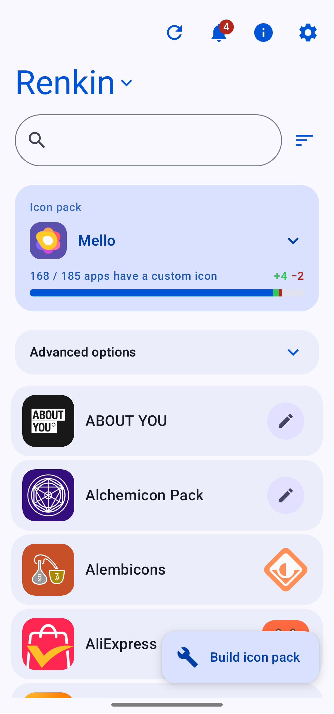
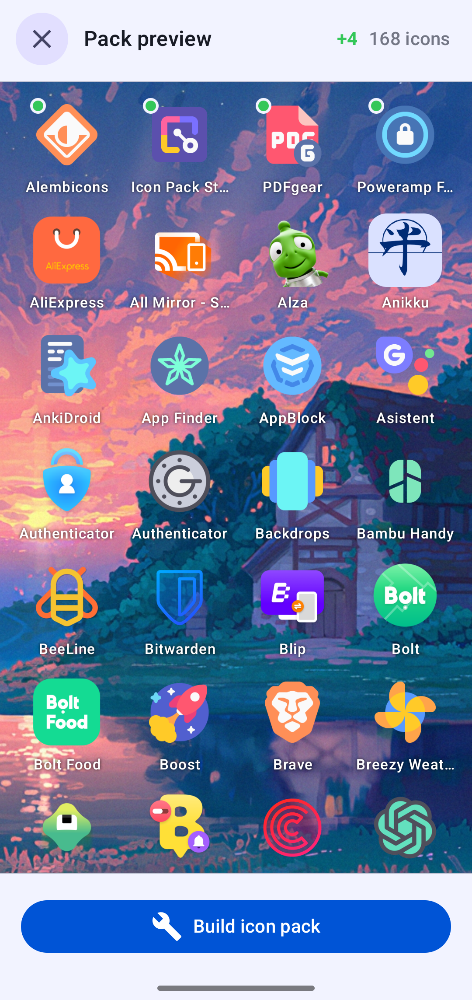
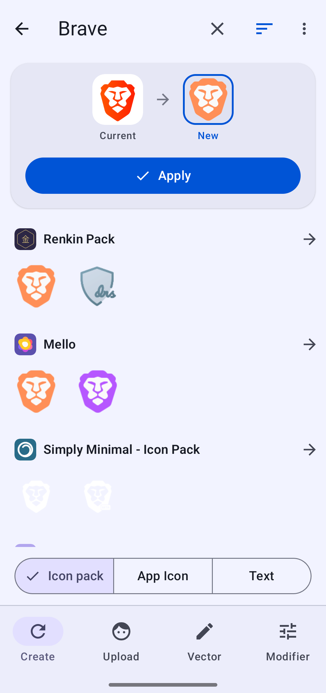
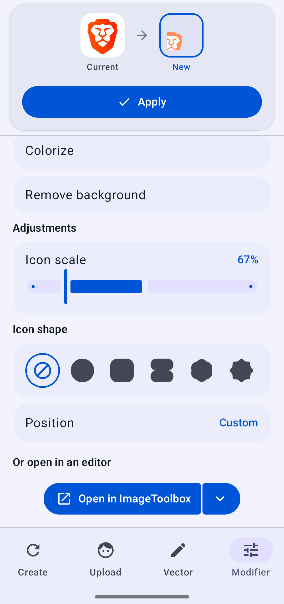

<p align="center">
  
</p>

<h1 align="center">Renkin</h1>

<p align="center">Make your own Android icon pack, on your phone.</p>

<p align="center">
  <a href="https://github.com/renkindevbugs/Renkin/actions/workflows/ci.yml"></a>
  <a href="https://github.com/renkindevbugs/Renkin/releases/latest"></a>
  <a href="https://f-droid.org/packages/dev.renkinProject.renkin/"></a>
  <a href="LICENSE"></a>
</p>

---

Renkin builds an installable icon pack from your own choices. Pick icons from packs you
already have, redraw or recolor them, and Renkin compiles and signs the pack on the phone.
Then you select it in your launcher. No PC, no account, works offline.

Renkin is a fork of [Alembicons](https://codeberg.org/kaanelloed/Alembicons) by kaanelloed
(formerly *Iconeration*).

## Download

<p align="center">
  <a href="https://f-droid.org/packages/dev.renkinProject.renkin/"></a>
  <a href="https://apps.obtainium.imranr.dev/redirect?r=obtainium://add/https://github.com/renkindevbugs/Renkin/"></a>
  <a href="https://github.com/renkindevbugs/Renkin/releases/latest"></a>
</p>

Requires Android 7.0 or newer.

- **F-Droid** builds Renkin from source and signs it with its own key.
- **Obtainium** installs the GitHub releases and keeps them updated. The badge opens
  Obtainium with this repository already filled in.
- **GitHub Releases** has the APK for each version.

F-Droid and GitHub builds have different signatures. Android will not update one with the
other. To switch, make a backup in Renkin, uninstall, install the other build and restore.

## Screenshots

<p align="center">
  
  
  
  
</p>

## Features

**Icons**
- Take an icon from any installed icon pack, from the app itself, or make one from the app's name.
- Import your own image for an app. SVG files stay sharp, or can be imported as editable paths.
- Use an app's vector or monochrome layer when it has one.
- Text icons with your own text, letter case and any system font (Arcticons Sans is bundled).
- Calendar icons that change with the date.
- Clock icons from packs that support them keep ticking in Nova and Lawnchair. Other launchers
  show a static icon.

**Editing**
- Path tracing, edge detection, colorize, background removal and vector editing.
- Outlines: add a colored contour or recolor an existing one. Erase parts of it with your finger.
- Shapes: crop an icon to a Material You shape, or place it on a colored shape.
- Themed (Material You) icons in the built pack.

**Profiles and backup**
- Profiles: several icon sets, each built as its own pack.
- Share a profile as a file. Icons from paid packs stay locked on the other phone until that
  pack is installed there.
- Backup and restore: one file with all profiles, settings, watch rules and uploads.

**Icon watch**
- Get a notification when a pack you follow adds an icon for one of your apps.

**Launcher support**
- Built packs include appfilter.xml, appmap.xml, theme_resources.xml and the icon_pack
  resource array, so most launchers can read them.
- Packs with themed icons also work as a Themed icons source in Lawnchair and Kvaesitso, and
  Material You packs tell Smart Launcher to theme the apps they don't cover.

## Reporting bugs

Open an issue with the [bug report form](https://github.com/renkindevbugs/Renkin/issues/new/choose).
It asks for your Renkin version, Android version, device and launcher. The Renkin version is
at the bottom of Settings. If Renkin crashed, copy the log from Settings → Crash logs and
paste it into the form.

Ideas go in the [feature request form](https://github.com/renkindevbugs/Renkin/issues/new/choose).

## Build

Kotlin, Jetpack Compose (Material 3), Hilt and Room. The pack APK is assembled and signed
on the device.

```
JAVA_HOME="<jdk-17>" ./gradlew assembleRelease
```

Architecture, persistence and known traps: [docs/ARCHITECTURE.md](docs/ARCHITECTURE.md).

## License

GPLv3, same as upstream Alembicons. See [LICENSE](LICENSE).
